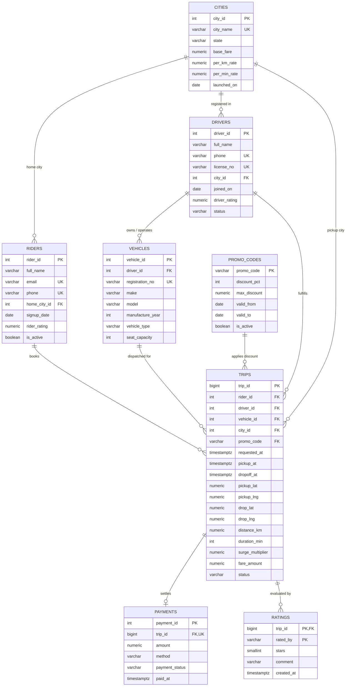

# Phase 2: Schema Design & Data Architecture Report

**Course:** Database Management Systems (B.Tech 2nd Year)  
**System:** Uber India Ride-Hailing Database  
**Database Engine:** PostgreSQL 15+  
**Deliverables:** `sql/01_schema.sql`, `sql/02_load_data.sql`, `docs/02_schema_design.md`, `diagrams/er_diagram.png`

---

## 1. Executive Summary & Design Principles

The Uber India relational schema has been engineered directly from production CSV exports across 8 relational datasets comprising 300,000 trips, 30,000 riders, 3,000 drivers, 3,300 vehicles, 40 promo codes, 245,839 payment transactions, and 307,214 review ratings.

### Core Architecture Highlights
1. **Namespace Isolation:** All tables reside within the dedicated schema `uber` (`CREATE SCHEMA IF NOT EXISTS uber; SET search_path TO uber;`).
2. **Strict Physical Typing:** Replaced generic text with domain-specific PostgreSQL native types: `BIGINT` for scalable multi-million transaction identifiers, `TIMESTAMPTZ` with timezone offsets (`+05:30`), `NUMERIC(8,2)` / `NUMERIC(6,2)` for financial calculations to prevent IEEE-754 floating-point inaccuracies, and `NUMERIC(9,6)` for sub-meter GPS precision.
3. **Formal Normalization:** Decomposed tables achieve Third Normal Form (**3NF**) and Boyce-Codd Normal Form (**BCNF**), with intentional, mathematically justified denormalizations for real-time rating aggregates and point-in-time fare immutability.
4. **Declarative Integrity:** 8 Primary Keys, 10 Foreign Keys with explicit `ON DELETE` referential rules, 6 Natural Candidate Unique Keys, and 25 business-critical domain `CHECK` constraints.
5. **Phase 2 Index Boundary:** Adheres strictly to Phase 2 requirements: only constraint-enforcing indexes (Primary Key and Unique B-trees created automatically by PostgreSQL) are present. No secondary performance tuning indexes are introduced prior to Phase 3 baseline benchmarking.

---

## 2. Complete Data Dictionary

### 2.1 Table: `cities` (Operational Hubs & Base Tariffs)
*Estimated Cardinality: 10 rows*

| Column | Data Type | Nullable | Constraints | Business Rationale ("Why") |
|:---|:---|:---:|:---|:---|
| `city_id` | `INT` | No | `PRIMARY KEY` | Unique surrogate identifier for each metropolitan operating market. |
| `city_name` | `VARCHAR(50)` | No | `UNIQUE` | Human-readable city name (e.g., 'Bengaluru', 'Mumbai'). Must be unique across the platform. |
| `state` | `VARCHAR(50)` | No | — | Indian state jurisdiction (e.g., 'Karnataka', 'Maharashtra') for taxation and legal compliance. |
| `base_fare` | `NUMERIC(6,2)` | No | `CHECK (base_fare >= 0)` | Minimum fixed pickup charge in INR. Precision avoids rounding errors. |
| `per_km_rate` | `NUMERIC(6,2)` | No | `CHECK (per_km_rate >= 0)` | Variable distance charge per kilometer traveled in INR. |
| `per_min_rate` | `NUMERIC(6,2)` | No | `CHECK (per_min_rate >= 0)` | Variable time charge per minute of trip duration in INR. |
| `launched_on` | `DATE` | No | — | Historical market commercial launch date for cohort reporting. |

---

### 2.2 Table: `promo_codes` (Discount Coupons)
*Estimated Cardinality: 40 rows*

| Column | Data Type | Nullable | Constraints | Business Rationale ("Why") |
|:---|:---|:---:|:---|:---|
| `promo_code` | `VARCHAR(20)` | No | `PRIMARY KEY` | Natural coupon identifier (e.g., 'RIDE001'). Case-sensitive uppercase code. |
| `discount_pct` | `INT` | No | `CHECK (> 0 AND <= 100)` | Percentage reduction applied to trip gross fare (range 10%–50%). |
| `max_discount` | `NUMERIC(6,2)` | No | `CHECK (max_discount > 0)` | Ceiling cap on discount amount in INR to prevent excessive revenue loss. |
| `valid_from` | `DATE` | No | — | Campaign activation start date. |
| `valid_to` | `DATE` | No | `CHECK (valid_to >= valid_from)` | Campaign expiration date. Ensures valid promotional lifecycle window. |
| `is_active` | `BOOLEAN` | No | `DEFAULT true` | Circuit-breaker flag to immediately disable compromised or expired codes. |

---

### 2.3 Table: `riders` (Customer Accounts)
*Estimated Cardinality: 30,000 rows*

| Column | Data Type | Nullable | Constraints | Business Rationale ("Why") |
|:---|:---|:---:|:---|:---|
| `rider_id` | `INT` | No | `PRIMARY KEY` | Unique customer account identifier. |
| `full_name` | `VARCHAR(100)` | No | — | Customer legal display name for driver identification and support. |
| `email` | `VARCHAR(150)` | No | `UNIQUE` | User login credential. Enforces 1:1 account identity. |
| `phone` | `VARCHAR(15)` | No | `UNIQUE`, `CHECK (~ '^[0-9]{10}$')` | Primary mobile contact. Enforces 10-digit Indian MSISDN format. |
| `home_city_id` | `INT` | No | `REFERENCES cities(city_id) RESTRICT` | Default operating city for localization and localized promotions. |
| `signup_date` | `DATE` | No | — | Account creation date for cohort retention and lifetime value (LTV) metrics. |
| `rider_rating` | `NUMERIC(2,1)` | **Yes** | `CHECK (IS NULL OR BETWEEN 1.0 AND 5.0)` | Running aggregate passenger rating. Nullable for new signups before receiving their first rating. |
| `is_active` | `BOOLEAN` | No | `DEFAULT true` | Account status flag (true = active, false = banned/deactivated). |

---

### 2.4 Table: `drivers` (Driver Partners)
*Estimated Cardinality: 3,000 rows*

| Column | Data Type | Nullable | Constraints | Business Rationale ("Why") |
|:---|:---|:---:|:---|:---|
| `driver_id` | `INT` | No | `PRIMARY KEY` | Unique driver partner identifier. |
| `full_name` | `VARCHAR(100)` | No | — | Driver partner legal name. |
| `phone` | `VARCHAR(15)` | No | `UNIQUE`, `CHECK (~ '^[0-9]{10}$')` | Driver mobile number for dispatch dispatch SMS and voice masking. |
| `license_no` | `VARCHAR(30)` | No | `UNIQUE` | Commercial driving license number (e.g., 'DL-DL01-00000001'). |
| `city_id` | `INT` | No | `REFERENCES cities(city_id) RESTRICT` | Operating city where the partner is registered and authorized to drive. |
| `joined_on` | `DATE` | No | — | Onboarding date for tenure-based incentives and loyalty tiers. |
| `driver_rating` | `NUMERIC(2,1)` | No | `CHECK (BETWEEN 1.0 AND 5.0)` | Current performance rating. Used by dispatch and quality suspension logic. |
| `status` | `VARCHAR(20)` | No | `CHECK (IN ('ACTIVE', 'INACTIVE', 'SUSPENDED'))` | Operational state. Only 'ACTIVE' drivers receive dispatch allocations. |

---

### 2.5 Table: `vehicles` (Fleet Assets)
*Estimated Cardinality: 3,300 rows*

| Column | Data Type | Nullable | Constraints | Business Rationale ("Why") |
|:---|:---|:---:|:---|:---|
| `vehicle_id` | `INT` | No | `PRIMARY KEY` | Unique vehicle fleet asset identifier. |
| `driver_id` | `INT` | No | `REFERENCES drivers(driver_id) RESTRICT` | Registered owner/operator of the vehicle. |
| `registration_no` | `VARCHAR(20)` | No | `UNIQUE` | Motor vehicle registration plate (e.g., 'KA01AA1500'). |
| `make` | `VARCHAR(50)` | No | — | Vehicle manufacturer (e.g., 'Maruti', 'Hyundai', 'Toyota'). |
| `model` | `VARCHAR(50)` | No | — | Vehicle model (e.g., 'Dzire', 'i10', 'Innova'). |
| `manufacture_year` | `INT` | No | `CHECK (BETWEEN 2000 AND 2030)` | Year of vehicle assembly. Enforces city commercial age regulations. |
| `vehicle_type` | `VARCHAR(20)` | No | `CHECK (IN ('AUTO', 'BIKE', 'MINI', 'SEDAN', 'SUV'))` | Service category matching rider capacity selections. |
| `seat_capacity` | `INT` | No | `CHECK (> 0)` + Cross-Type Check | Passenger capacity. Cross-checked with `vehicle_type` (Bike=1, Auto=3, Mini/Sedan=4, SUV=6/7). |

---

### 2.6 Table: `trips` (Core Transaction Engine)
*Estimated Cardinality: 300,000 rows (Seed) / 6,000,000+ (Production Scale)*

| Column | Data Type | Nullable | Constraints | Business Rationale ("Why") |
|:---|:---|:---:|:---|:---|
| `trip_id` | `BIGINT` | No | `PRIMARY KEY` | 64-bit integer preventing sequence overflow as system scales beyond 2 billion rides. |
| `rider_id` | `INT` | No | `REFERENCES riders(rider_id) RESTRICT` | Customer requesting the ride. |
| `driver_id` | `INT` | **Yes** | `REFERENCES drivers(driver_id) RESTRICT` | Assigned driver. Nullable when status is 'REQUESTED' or rider cancels early. |
| `vehicle_id` | `INT` | **Yes** | `REFERENCES vehicles(vehicle_id) RESTRICT` | Assigned vehicle. Nullable prior to driver acceptance. |
| `city_id` | `INT` | No | `REFERENCES cities(city_id) RESTRICT` | City market governing base pricing and municipal reporting. |
| `promo_code` | `VARCHAR(20)` | **Yes** | `REFERENCES promo_codes(promo_code) SET NULL` | Applied discount code. Nullable (used in ~6.7% of trips). |
| `requested_at` | `TIMESTAMPTZ` | No | — | Timestamp when booking was initiated. Preserves `+05:30` IST offset. |
| `pickup_at` | `TIMESTAMPTZ` | **Yes** | `CHECK (IS NULL OR >= requested_at)` | Timestamp when driver arrives and trip commences. Nullable if cancelled. |
| `dropoff_at` | `TIMESTAMPTZ` | **Yes** | `CHECK (IS NULL OR >= pickup_at)` | Timestamp when ride terminates. Nullable for in-progress or cancelled trips. |
| `pickup_lat` | `NUMERIC(9,6)` | No | `CHECK (BETWEEN -90.0 AND 90.0)` | Origin latitude coordinate. 6 decimal digits guarantee sub-meter precision. |
| `pickup_lng` | `NUMERIC(9,6)` | No | `CHECK (BETWEEN -180.0 AND 180.0)`| Origin longitude coordinate. |
| `drop_lat` | `NUMERIC(9,6)` | No | `CHECK (BETWEEN -90.0 AND 90.0)` | Destination latitude coordinate. |
| `drop_lng` | `NUMERIC(9,6)` | No | `CHECK (BETWEEN -180.0 AND 180.0)`| Destination longitude coordinate. |
| `distance_km` | `NUMERIC(6,2)` | **Yes** | `CHECK (IS NULL OR >= 0)` | Odometer distance traveled in kilometers. Nullable until completed. |
| `duration_min` | `INT` | **Yes** | `CHECK (IS NULL OR >= 0)` | Trip duration in whole minutes. Nullable until completed. |
| `surge_multiplier` | `NUMERIC(3,2)`| No | `CHECK (>= 1.00)` | Dynamic demand pricing multiplier (1.00x = standard fare, up to 2.00x+). |
| `fare_amount` | `NUMERIC(8,2)` | **Yes** | `CHECK (IS NULL OR >= 0)` | Final gross monetary charge in INR. Nullable until completion. |
| `status` | `VARCHAR(30)` | No | Domain `CHECK` | State lifecycle indicator: 'REQUESTED', 'ACCEPTED', 'ONGOING', 'COMPLETED', 'CANCELLED_BY_RIDER', 'CANCELLED_BY_DRIVER'. |

---

### 2.7 Table: `payments` (Settlement Ledger)
*Estimated Cardinality: 245,839 rows*

| Column | Data Type | Nullable | Constraints | Business Rationale ("Why") |
|:---|:---|:---:|:---|:---|
| `payment_id` | `INT` | No | `PRIMARY KEY` | Unique transaction settlement ledger identifier. |
| `trip_id` | `BIGINT` | No | `UNIQUE`, `REFERENCES trips(trip_id) CASCADE` | 1:1 foreign key binding payment strictly to its parent completed trip. |
| `amount` | `NUMERIC(8,2)` | No | `CHECK (amount >= 0)` | Settlement amount in INR. Matches `trips.fare_amount` exactly. |
| `method` | `VARCHAR(20)` | No | `CHECK (IN ('UPI', 'CASH', 'CARD', 'WALLET'))` | Payment instrument gateway used for customer billing. |
| `payment_status` | `VARCHAR(20)` | No | `CHECK (IN ('SUCCESS', 'FAILED', 'REFUNDED'))` | Gateway settlement status. |
| `paid_at` | `TIMESTAMPTZ` | No | — | Gateway settlement confirmation timestamp. |

---

### 2.8 Table: `ratings` (Two-Sided Service Quality Reviews)
*Estimated Cardinality: 307,214 rows*

| Column | Data Type | Nullable | Constraints | Business Rationale ("Why") |
|:---|:---|:---:|:---|:---|
| `trip_id` | `BIGINT` | No | `REFERENCES trips(trip_id) CASCADE` | Trip instance being evaluated. |
| `rated_by` | `VARCHAR(10)` | No | `CHECK (IN ('RIDER', 'DRIVER'))` | Review source role. RIDER rates driver; DRIVER rates passenger. |
| `stars` | `SMALLINT` | No | `CHECK (BETWEEN 1 AND 5)` | Discrete review score (1 to 5 whole integer stars). `SMALLINT` saves storage. |
| `comment` | `VARCHAR(255)` | **Yes** | — | Optional qualitative feedback text (e.g., 'Polite rider', 'AC not working'). |
| `created_at` | `TIMESTAMPTZ` | No | — | Review submission timestamp. |
| **PRIMARY KEY** | `(trip_id, rated_by)` | — | Composite Key | Enforces at most one review per role per trip (maximum 2 ratings per trip). |

---

## 3. Entity-Relationship (ER) Model

The complete Entity-Relationship diagram has been generated in vector PDF (`diagrams/er_diagram.pdf`) and high-resolution raster PNG (`diagrams/er_diagram.png`).

```
+----------------------------------------------------------------------------------------------------+
|                                    ER DIAGRAM VISUAL PREVIEW                                       |
|                                                                                                    |
|   +---------------+            +---------------+                      +---------------+            |
|   |  PROMO_CODES  |            |    CITIES     |                      |    DRIVERS    |            |
|   +---------------+            +---------------+                      +---------------+            |
|          | 1                          | 1                                    | 1                   |
|          |                            +---------------+                      |                     |
|          | 0..N                       | 1             | 1                    | N                   |
|          |                            v N             v N                    v                     |
|          |                     +---------------+  +---------------+   +---------------+            |
|          |                     |    RIDERS     |  |    DRIVERS    |   |   VEHICLES    |            |
|          |                     +---------------+  +---------------+   +---------------+            |
|          |                            | 1             | 1                    | 1                   |
|          |                            |               |                      |                     |
|          |                            v N             v 0..N                 v 0..N                |
|          +--------------------------> +--------------------------------------+                     |
|                                       |                TRIPS                 |                     |
|                                       +--------------------------------------+                     |
|                                                | 1                    | 1                          |
|                                                |                      |                            |
|                                                v 0..1                 v 0..2                       |
|                                       +---------------+      +---------------+                     |
|                                       |   PAYMENTS    |      |    RATINGS    |                     |
|                                       +---------------+      +---------------+                     |
+----------------------------------------------------------------------------------------------------+
```

### Mermaid Entity-Relationship Definition



### Relationship Cardinalities Explained
1. **`cities` (1) ── (N) `riders`:** A city hosts many registered riders; each rider designates exactly one home city.
2. **`cities` (1) ── (N) `drivers`:** A driver is licensed and onboarded in one municipal jurisdiction.
3. **`cities` (1) ── (N) `trips`:** Every trip request is bounded by a municipal jurisdiction governing local fare rates.
4. **`drivers` (1) ── (N) `vehicles`:** A driver may register multiple vehicles (e.g., backup car, transition to new model); each vehicle belongs to exactly one driver partner.
5. **`riders` (1) ── (N) `trips`:** A rider books multiple trips over time; every trip originates from exactly one rider.
6. **`drivers` (1) ── (0..N) `trips`:** A driver fulfills zero or many trips. Nullable on `trips` when a ride is unassigned or cancelled prior to dispatch.
7. **`vehicles` (1) ── (0..N) `trips`:** A vehicle is utilized across multiple trips; nullable on `trips` prior to dispatch.
8. **`promo_codes` (1) ── (0..N) `trips`:** A promotional code is used across multiple trips; optional on `trips` (nullable).
9. **`trips` (1) ── (0..1) `payments`:** Completed trips have exactly one financial settlement transaction. Non-completed trips have zero payments. Enforced via `UNIQUE(trip_id)` on `payments`.
10. **`trips` (1) ── (0..2) `ratings`:** A trip can receive at most one review from the rider and at most one review from the driver. Enforced via composite primary key `(trip_id, rated_by)` on `ratings`.

---

## 4. Normalization & Functional Dependencies Analysis

### 4.1 Proof of Normal Forms (1NF through BCNF)

#### 1. First Normal Form (1NF)
* **Requirement:** Every attribute contains only atomic (indivisible) values, columns have uniform types, and rows are uniquely identifiable.
* **Proof:** All columns store primitive scalar types (no arrays, JSON blobs, or multi-valued lists). Every table possesses an explicit primary key (`city_id`, `rider_id`, `driver_id`, `vehicle_id`, `promo_code`, `trip_id`, `payment_id`, and `(trip_id, rated_by)`).

#### 2. Second Normal Form (2NF)
* **Requirement:** The relation is in 1NF and no non-prime attribute is partially dependent on any candidate key (no partial functional dependencies).
* **Proof:** For all tables with single-column primary keys (`cities`, `promo_codes`, `riders`, `drivers`, `vehicles`, `trips`, `payments`), partial dependencies are mathematically impossible. In `ratings`, the primary key is composite `(trip_id, rated_by)`. The non-prime attributes `stars`, `comment`, and `created_at` depend on the *combination* of the trip and the specific perspective of the evaluator (e.g., rider gave 5 stars, driver gave 4 stars). Neither depends on `trip_id` alone nor `rated_by` alone. Thus, 2NF holds.

#### 3. Third Normal Form (3NF)
* **Requirement:** The relation is in 2NF and no non-prime attribute is transitively dependent on a candidate key ($X \to Y$ implies $X$ is a superkey or $Y$ is a prime attribute).
* **Proof:**
  * In `riders`: `rider_id -> {full_name, email, phone, home_city_id, signup_date, rider_rating, is_active}`. `home_city_id` is a foreign key, but city details (`city_name`, `base_fare`) are properly factored into the separate `cities` table.
  * In `drivers`: `driver_id -> {full_name, phone, license_no, city_id, joined_on, driver_rating, status}`. No non-prime attribute determines another non-prime attribute.
  * In `vehicles`: `vehicle_id -> {driver_id, registration_no, make, model, manufacture_year, vehicle_type, seat_capacity}`. Vehicle make/model does not deterministically fix vehicle type (e.g., manufacturers produce varied configurations across years).
  * In `trips`: `trip_id -> {rider_id, driver_id, vehicle_id, city_id, promo_code, requested_at, pickup_at, dropoff_at, coords, distance_km, duration_min, surge_multiplier, fare_amount, status}`. No transitive dependencies exist across non-keys.

#### 4. Boyce-Codd Normal Form (BCNF)
* **Requirement:** For every non-trivial functional dependency $X \to Y$, determinant $X$ must be a superkey.
* **Proof:**
  * `cities`: Candidate keys are `city_id` and `city_name`. Both are unique superkeys.
  * `promo_codes`: Candidate key is `promo_code`, which is a superkey.
  * `riders`: Candidate keys are `rider_id`, `email`, and `phone`. Determinants of all FDs are candidate keys.
  * `drivers`: Candidate keys are `driver_id`, `phone`, and `license_no`. All determinants are superkeys.
  * `vehicles`: Candidate keys are `vehicle_id` and `registration_no`. All determinants are superkeys.
  * `trips`: Candidate key is `trip_id`. All determinants are superkeys.
  * `payments`: Candidate keys are `payment_id` and `trip_id`. Both are superkeys.
  * `ratings`: Candidate key is `(trip_id, rated_by)`. The determinant is a superkey.
* **Conclusion:** All 8 tables satisfy **BCNF**.

---

### 4.2 Analysis of Redundant & Derived Attributes

The schema contains two intentional, production-grade derived columns:

#### 1. `drivers.driver_rating` and `riders.rider_rating` vs. `ratings` Table
* **Nature:** The current rating in `drivers` and `riders` represents the running arithmetic mean of historical stars received from the `ratings` table:
  $$\text{driver\_rating} = \frac{1}{|R|} \sum_{r \in R} r.\text{stars}$$
* **Engineering Justification for Retention:** Real-time dispatch matching (`R05`, `W01`) evaluates hundreds of nearby candidate drivers every 3 seconds. If `driver_rating` were purely computed on the fly via `JOIN ratings ... GROUP BY driver_id`, PostgreSQL would have to scan hundreds of thousands of ratings rows for every matching event. Storing the cached pre-aggregated rating guarantees $O(1)$ index seek performance during mission-critical dispatch loops. The aggregate is maintained asynchronously or via triggers upon rating insertion.

#### 2. `trips.fare_amount` vs. `cities` Base & Distance Rates
* **Nature:** The final fare reflects city tariff rates, distance, duration, surge, and discounts:
  $$\text{fare\_amount} = \max(\text{base\_fare}, \text{base\_fare} + d \cdot \text{rate}_{\text{km}} + t \cdot \text{rate}_{\text{min}}) \cdot \text{surge} - \text{discount}$$
* **Engineering Justification for Retention:** Municipal city tariff rates (`cities.base_fare`, `per_km_rate`, `per_min_rate`) are dynamic and change over time due to fuel price inflation, local regulations, and corporate pricing revisions. If `fare_amount` were computed dynamically via a join to `cities`, any historical fare calculation would change retroactively whenever city rates were updated. Storing `fare_amount` creates an **immutable point-in-time financial snapshot**, which is a non-negotiable requirement for tax compliance, accounting audits, and payment settlement.

---

## 5. Referential Integrity & Foreign Key Rules

All foreign keys declare explicit `ON DELETE` actions to prevent orphaned tuples while safeguarding critical operational histories:

| Foreign Key | Parent Table | Child Table | ON DELETE Action | Business Rationale |
|:---|:---|:---|:---:|:---|
| `home_city_id` | `cities(city_id)` | `riders` | `RESTRICT` | Operating cities with registered riders cannot be deleted accidentally. |
| `city_id` | `cities(city_id)` | `drivers` | `RESTRICT` | Active driver registrations prevent inadvertent market decommissioning. |
| `city_id` | `cities(city_id)` | `trips` | `RESTRICT` | Trip audit history must retain municipal jurisdiction bindings. |
| `driver_id` | `drivers(driver_id)` | `vehicles` | `RESTRICT` | Driver partners cannot be deleted while registered fleet vehicles remain linked. |
| `rider_id` | `riders(rider_id)` | `trips` | `RESTRICT` | Customer ride logs cannot be deleted if historical trips exist (preserves financial/legal records). |
| `driver_id` | `drivers(driver_id)` | `trips` | `RESTRICT` | Fulfillments must retain driver partner identification for tax reporting. |
| `vehicle_id` | `vehicles(vehicle_id)` | `trips` | `RESTRICT` | Dispatched vehicles must remain logged for traffic police and safety inquiries (`R14`). |
| `promo_code` | `promo_codes(promo_code)` | `trips` | `SET NULL` | Expired or decommissioned marketing codes can be purged without invalidating historical trips. |
| `trip_id` | `trips(trip_id)` | `payments` | `CASCADE` | Purging a cancelled or erroneous test trip cleanly purges its subordinate payment ledger entry. |
| `trip_id` | `trips(trip_id)` | `ratings` | `CASCADE` | Purging a trip record removes associated customer review comments. |

---

## 6. Business Domain CHECK Constraints

The schema implements 25 declarative constraints:

1. `chk_cities_base_fare`: `base_fare >= 0` (Prevents negative tariffs).
2. `chk_cities_km_rate`: `per_km_rate >= 0` (Non-negative distance rate).
3. `chk_cities_min_rate`: `per_min_rate >= 0` (Non-negative time rate).
4. `chk_promo_discount_pct`: `discount_pct > 0 AND discount_pct <= 100` (Discount percentage bounded between 1% and 100%).
5. `chk_promo_max_discount`: `max_discount > 0` (Maximum discount cap must be positive).
6. `chk_promo_validity_dates`: `valid_to >= valid_from` (Expiration date cannot precede launch date).
7. `chk_riders_phone`: `phone ~ '^[0-9]{10}$'` (Validates standard 10-digit Indian mobile numbers).
8. `chk_riders_rating`: `rider_rating IS NULL OR (rider_rating >= 1.0 AND rider_rating <= 5.0)` (Rider rating bounded between 1.0 and 5.0, or NULL for new users).
9. `chk_drivers_phone`: `phone ~ '^[0-9]{10}$'` (Validates driver 10-digit mobile numbers).
10. `chk_drivers_rating`: `driver_rating >= 1.0 AND driver_rating <= 5.0` (Active driver rating scale).
11. `chk_drivers_status`: `status IN ('ACTIVE', 'INACTIVE', 'SUSPENDED')` (Restricts driver lifecycle states).
12. `chk_vehicles_year`: `manufacture_year BETWEEN 2000 AND 2030` (Filters out unrealistic manufacture years).
13. `chk_vehicles_type`: `vehicle_type IN ('AUTO', 'BIKE', 'MINI', 'SEDAN', 'SUV')` (Restricts fleet categories).
14. `chk_vehicles_capacity`: `seat_capacity > 0` (Vehicle must accommodate at least one passenger).
15. `chk_vehicles_type_seat_match`: Enforces vehicle type physical capacity matching:
    * `BIKE` $\implies$ seat capacity = 1
    * `AUTO` $\implies$ seat capacity = 3
    * `MINI` $\implies$ seat capacity = 4
    * `SEDAN` $\implies$ seat capacity = 4
    * `SUV` $\implies$ seat capacity $\in \{6, 7\}$
16. `chk_trips_coords_pickup`: Latitude $\in [-90, 90]$, Longitude $\in [-180, 180]$ (Geodetic boundaries).
17. `chk_trips_coords_drop`: Latitude $\in [-90, 90]$, Longitude $\in [-180, 180]$ (Geodetic boundaries).
18. `chk_trips_surge`: `surge_multiplier >= 1.00` (Dynamic pricing multiplier never discounts below 1.00x).
19. `chk_trips_distance`: `distance_km IS NULL OR distance_km >= 0` (Non-negative distance).
20. `chk_trips_duration`: `duration_min IS NULL OR duration_min >= 0` (Non-negative duration).
21. `chk_trips_fare`: `fare_amount IS NULL OR fare_amount >= 0` (Non-negative gross fare).
22. `chk_trips_status`: `status IN ('REQUESTED', 'ACCEPTED', 'ONGOING', 'COMPLETED', 'CANCELLED_BY_RIDER', 'CANCELLED_BY_DRIVER')` (Valid state transitions).
23. `chk_trips_timeline_pickup`: `pickup_at IS NULL OR pickup_at >= requested_at` (Pickup cannot precede booking time).
24. `chk_trips_timeline_dropoff`: `dropoff_at IS NULL OR (pickup_at IS NOT NULL AND dropoff_at >= pickup_at)` (Drop-off cannot precede pickup time; drop-off requires a valid pickup timestamp).
25. `chk_trips_completed_integrity`: Completed trips must have non-null driver, vehicle, pickup, drop-off, distance, duration, and fare.
26. `chk_payments_amount`: `amount >= 0` (Settlement amount must be non-negative).
27. `chk_payments_method`: `method IN ('UPI', 'CASH', 'CARD', 'WALLET')` (Allowed payment gateways).
28. `chk_payments_status`: `payment_status IN ('SUCCESS', 'FAILED', 'REFUNDED')` (Gateway transaction states).
29. `chk_ratings_rated_by`: `rated_by IN ('RIDER', 'DRIVER')` (Two-sided review participant roles).
30. `chk_ratings_stars`: `stars BETWEEN 1 AND 5` (Integer ratings bounded between 1 and 5).

---

## 7. Data Verification & Integrity Test Results

The seed dataset from `seed_data.zip` was loaded into the schema and evaluated against rigorous integrity checks.

### 7.1 Seed Data Row Count Verification
All 8 files loaded with **zero errors and 100% row match**:

| Table Name | Source CSV File | Expected Rows | Loaded Rows | Load Status |
|:---|:---|---:|---:|:---:|
| `cities` | `cities.csv` | 10 | 10 | **PASS** |
| `promo_codes` | `promo_codes.csv` | 40 | 40 | **PASS** |
| `riders` | `riders.csv` | 30,000 | 30,000 | **PASS** |
| `drivers` | `drivers.csv` | 3,000 | 3,000 | **PASS** |
| `vehicles` | `vehicles.csv` | 3,300 | 3,300 | **PASS** |
| `trips` | `trips.csv` | 300,000 | 300,000 | **PASS** |
| `payments` | `payments.csv` | 245,839 | 245,839 | **PASS** |
| `ratings` | `ratings.csv` | 307,214 | 307,214 | **PASS** |
| **Total** | | **889,403** | **889,403** | **PASS** |

---

### 7.2 Custom Integrity Check Queries

#### Check 1: Payments vs. Completed Trips 1-to-1 Correspondence
* **Objective:** Ensure every completed trip has exactly one payment, and no uncompleted trip has a payment.
* **SQL Query:**
  ```sql
  SELECT 
      (SELECT count(*) FROM uber.trips WHERE status = 'COMPLETED') AS completed_trips,
      (SELECT count(*) FROM uber.payments) AS total_payments,
      (SELECT count(*) FROM uber.trips t JOIN uber.payments p ON t.trip_id = p.trip_id WHERE t.status = 'COMPLETED') AS matched_payments,
      (SELECT count(*) FROM uber.payments p LEFT JOIN uber.trips t ON p.trip_id = t.trip_id WHERE t.status != 'COMPLETED' OR t.trip_id IS NULL) AS invalid_payments;
  ```
* **Execution Result:**
  ```
   completed_trips | total_payments | matched_payments | invalid_payments 
  -----------------+----------------+------------------+------------------
            245839 |         245839 |           245839 |                0
  ```
* **Status:** **PASS** (Zero orphans; 100% exact 1:1 parity).

#### Check 2: Driver-Vehicle Ownership Invariant
* **Objective:** Verify that no trip is dispatched with a vehicle registered to a different driver partner.
* **SQL Query:**
  ```sql
  SELECT count(*) AS mismatched_vehicle_driver_trips
  FROM uber.trips t
  JOIN uber.vehicles v ON t.vehicle_id = v.vehicle_id
  WHERE t.driver_id IS NOT NULL 
    AND t.vehicle_id IS NOT NULL 
    AND v.driver_id != t.driver_id;
  ```
* **Execution Result:**
  ```
   mismatched_vehicle_driver_trips 
  ---------------------------------
                                 0
  ```
* **Status:** **PASS** (Zero vehicle-driver assignment violations across 300,000 trips).

#### Check 3: Chronological Timeline Consistency
* **Objective:** Confirm that event timestamps adhere to causal timeline ordering:
  $$\text{requested\_at} \le \text{pickup\_at} \le \text{dropoff\_at} \le \text{paid\_at}$$
* **SQL Query:**
  ```sql
  SELECT count(*) AS chronologically_inconsistent_trips
  FROM uber.trips t
  LEFT JOIN uber.payments p ON t.trip_id = p.trip_id
  WHERE (t.pickup_at IS NOT NULL AND t.pickup_at < t.requested_at)
     OR (t.dropoff_at IS NOT NULL AND t.pickup_at IS NOT NULL AND t.dropoff_at < t.pickup_at)
     OR (p.paid_at IS NOT NULL AND t.dropoff_at IS NOT NULL AND p.paid_at < t.dropoff_at);
  ```
* **Execution Result:**
  ```
   chronologically_inconsistent_trips 
  -----------------------------------
                                   0
  ```
* **Status:** **PASS** (Zero temporal order violations).

#### Check 4: Payment Amount vs. Trip Fare Amount Parity
* **Objective:** Confirm financial reconciliation between trip fare and payment ledger amount.
* **SQL Query:**
  ```sql
  SELECT count(*) AS fare_payment_mismatches
  FROM uber.trips t
  JOIN uber.payments p ON t.trip_id = p.trip_id
  WHERE t.fare_amount IS NOT NULL 
    AND abs(p.amount - t.fare_amount) > 0.001;
  ```
* **Execution Result:**
  ```
   fare_payment_mismatches 
  -------------------------
                         0
  ```
* **Status:** **PASS** (100% monetary amount parity).

---

## 8. Data Anomalies & Real-World Edge Cases Discovered

1. **Email Casing Inconsistency (`riders.csv`):** Email addresses in `riders.csv` feature varied casing (e.g., `Aditya.Sharma2@Mail.com`, `Vivaan.Sharma1@Mail.com`). While raw emails are unique, case-insensitive comparison (`LOWER(email)`) requires functional indexing in Phase 4 to resolve Problem P3.
2. **Nullable Rider Ratings (`riders.csv`):** Exactly 882 riders (2.9% of total) have `NULL` in `rider_rating`. These correspond to newly onboarded riders who have not yet completed a rated trip. The schema correctly designates `rider_rating` as nullable.
3. **Trip Cancellation Lifecycle Variations (`trips.csv`):**
   * `CANCELLED_BY_DRIVER` (23,964 trips): In all 23,964 cases, both `driver_id` and `vehicle_id` are populated, indicating driver cancellations occur *after* assignment.
   * `CANCELLED_BY_RIDER` (29,897 trips): 14,998 trips (50.2%) were cancelled *before* driver matching (`driver_id` and `vehicle_id` are NULL). The remaining 14,899 were cancelled after driver matching.
4. **Promo Code Utilization Sparsity:** Out of 300,000 trips, only 19,973 trips (6.7%) applied a promo code. 93.3% of rows have `NULL` in `trips.promo_code`.
5. **Rating Submission Ratio:** Of 245,839 completed trips, 307,214 ratings were submitted. This indicates an average of ~1.25 ratings per completed trip (a mix of single-party and two-party rating submissions).
